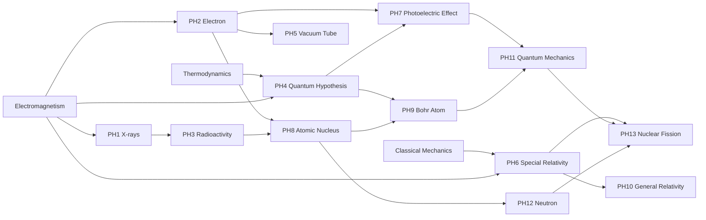

# Example Tech Tree — Physics (1900–1945) — DRAFT FOR REVIEW

A small example to show how research works. Every tech has an ID (PH1, PH2…) so you can comment by number. RP costs are first guesses for play-testing.

## How it works

- **Tech states:**
  - **Hidden:** not all prerequisites are done; the player can't see it yet.
  - **Discovered:** every prerequisite is done. The tech appears on the tree showing its **RP cost** and **estimated time**. The player can queue it.
  - **Unlocked:** all its RP are paid; whatever it unlocks becomes available.
- **Eras don't gate research.** A tech's era and year are labels for flavor and pacing; a tech becomes discovered the moment its prerequisites are done, whatever the date or era.
- **Estimated time = RP remaining ÷ RP per tick going into it.** Adding RP (more labs, more funding, university points, a great scientist's bonus) shortens the time, and the estimate updates live.
- **Great scientists unlock their discovery immediately when they arrive** (see below).

## Starting knowledge (already unlocked in 1900)

| ID | Tech |
|---|---|
| PH0a | Classical Mechanics |
| PH0b | Thermodynamics |
| PH0c | Electromagnetism |

## The tree

| ID | Tech | Year | Prerequisites | Cost (RP) | Unlocks (examples) |
|---|---|---|---|---|---|
| PH1 | X-rays | 1895 | Electromagnetism | 300 | X-ray machine (medical), weld inspection |
| PH2 | Electron | 1897 | Electromagnetism | 300 | cathode-ray tube |
| PH3 | Radioactivity | 1898 | X-rays | 600 | radium source, Geiger counter |
| PH4 | Quantum Hypothesis | 1900 | Thermodynamics, Electromagnetism | 800 | — (opens later physics) |
| PH5 | Vacuum Tube | 1904 | Electron | 1,000 | radio transmitter, radio receiver, amplifier |
| PH6 | Special Relativity | 1905 | Classical Mechanics, Electromagnetism | 1,500 | — (opens later physics) |
| PH7 | Photoelectric Effect | 1905 | Electron, Quantum Hypothesis | 1,500 | photocell, light meter |
| PH8 | Atomic Nucleus | 1911 | Electron, Radioactivity | 2,500 | radiation shielding |
| PH9 | Bohr Atom | 1913 | Atomic Nucleus, Quantum Hypothesis | 3,000 | spectrometer (chemistry analysis) |
| PH10 | General Relativity | 1915 | Special Relativity | 4,000 | precision astronomy; much later, gravity research toward FTL |
| PH11 | Quantum Mechanics | 1926 | Bohr Atom, Photoelectric Effect | 6,000 | — (opens semiconductors later) |
| PH12 | Neutron | 1932 | Atomic Nucleus | 5,000 | neutron source |
| PH13 | Nuclear Fission | 1938 | Neutron, Quantum Mechanics, Special Relativity | 10,000 | research reactor; later nuclear power plants |

Total: 36,500 RP.

## Example: how the timing plays out

It's 1902. The player has completed X-rays and Electron, so **Radioactivity (600 RP)**, **Vacuum Tube (1,000 RP)** and **Quantum Hypothesis (800 RP)** are now discovered and visible.

The player queues Vacuum Tube:

| Research going in | Time to unlock (1,000 RP) | At 1x speed |
|---|---|---|
| 1 physics lab, fully funded (2 RP/tick) | 500 ticks (~167 days) | ~17 min |
| + a second lab (4 RP/tick) | 250 ticks (~83 days) | ~8 min |
| + university points (6 RP/tick) | 167 ticks (~56 days) | ~6 min |

A lab costs 5 GORE/tick to run, so the second lab trades about 1,250 GORE of funding for 83 days sooner.

**Pacing check:** at a steady 2 RP/tick, the whole tree takes about 18,250 ticks (~17 game years), versus 38 real years (1900–1938). A modest research effort runs ahead of history; costs can be tuned in play-testing.

## Great scientists (real historical figures)

Each scientist arrives at a random point in their window, once per game, **as long as their breakthrough tech's prerequisites are done**. If the prerequisites aren't done yet, they arrive as soon as they are. On arrival, **their breakthrough unlocks immediately** (no RP needed), and they then add a research bonus for the rest of their career.

| Scientist | Window | Breakthrough (unlocks immediately) | Career bonus |
|---|---|---|---|
| Wilhelm Röntgen | 1900–1903 | PH1 X-rays | +10% physics |
| J. J. Thomson | 1900–1905 | PH2 Electron | +10% physics |
| Marie Curie | 1900–1910 | PH3 Radioactivity | +15% physics and chemistry |
| Max Planck | 1900–1908 | PH4 Quantum Hypothesis | +10% physics |
| John Ambrose Fleming | 1904–1910 | PH5 Vacuum Tube | +10% physics |
| Albert Einstein | 1905–1915 | PH6 Special Relativity | +20% physics |
| Ernest Rutherford | 1909–1919 | PH8 Atomic Nucleus | +15% physics |
| Niels Bohr | 1913–1922 | PH9 Bohr Atom | +15% physics |
| Werner Heisenberg | 1925–1932 | PH11 Quantum Mechanics | +15% physics |
| James Chadwick | 1932–1938 | PH12 Neutron | +10% physics |
| Lise Meitner | 1938–1945 | PH13 Nuclear Fission | +15% physics |

Röntgen's and Thomson's real discoveries (1895, 1897) were just before the game starts; their windows begin in 1900 so the player can still meet them.

## Questions for you

1. **Is there a minimum research time?** Right now, enough RP can unlock anything in a single tick. Should each tech have a minimum time (e.g. Nuclear Fission can't take less than a year) so spending has diminishing returns?
2. **Starting knowledge:** should the 1890s discoveries (X-rays, Electron, Radioactivity) be already unlocked at the start, or stay as quick early research (current draft)?
3. **Do RP costs and the pacing feel right** for a start, or should research take closer to real history?
